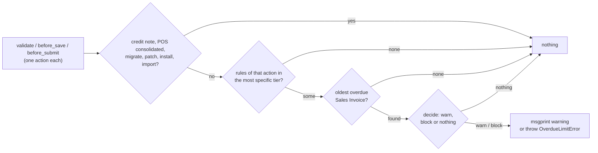

# Time Based Overdue Limit

Developer + power-user reference for the **Time Based Overdue Limit** doctype: when its check runs
on Sales Invoices and Sales Orders, which rules apply, how the overdue days are counted, and which
hook checks each action. For a click-by-click guide aimed at accountants, see
[user-guide.md](user-guide.md).

---

## What it is

A credit-control rule keyed on the **age** of a customer's debt rather than its amount. It is
ERPNext's Credit Limit (`erpnext/selling/doctype/customer/customer.py`, `check_credit_limit`) with
the same shape: rules on Customer and Customer Group, a customer rule overriding its group's, and
a role that is let through. A rule names one party, an optional company, a day threshold and one
of three actions, and each action is checked at one hook of **Sales Invoice** and **Sales Order**:
Warn on Save at `validate`, Block on Save at `before_save`, Block on Submit at `before_submit`. It
warns with `frappe.msgprint` or blocks with `frappe.throw`, and needs no client script.

The doctype is wholly owned by this app and adds no field to another app's doctype, so the
[setup framework](../setup/architecture.md) and its `sync()` patches are not involved.

---

## Where the code lives

The work is split into deciding and doing. The decisions are plain functions that take rows and
return values, with no database access. Everything that reads calls them.

```
optima_payment/overdue_limit/
└── limit.py
    ├── DECISIONS   # pure: skipped documents, rule selection by tier and action, day count,
    │               #       exemption, the document's verdict
    ├── MESSAGES    # the warning / refusal text, one line per rule
    ├── CHECK       # check(doc, action): loads, decides, then msgprint or throw
    └── QUERIES     # group chain, enabled rules + exempt roles, oldest overdue invoice

optima_payment/doc_events/overdue_limit.py   # validate / before_save / before_submit → limit.check, one action each
optima_payment/hooks.py                      # doc_events for Sales Invoice and Sales Order

optima_payment/optima_payment/doctype/
├── time_based_overdue_limit/                # the rule; controller validates threshold and duplicates
└── time_based_overdue_limit_exempt_role/    # child table, one Role per row
```

---

## Data model

**Time Based Overdue Limit** (not submittable, named `TBOL-.#####`, title `party`):

| Field | Type | Notes |
|-------|------|-------|
| `enabled` | Check | Default 1. Only enabled rules are loaded or count as duplicates |
| `applies_to` | Select | Customer / Customer Group. Default Customer |
| `party` | Dynamic Link → `applies_to` | Required |
| `company` | Link Company | Optional. Blank means every company (see [Blank company](#blank-company)) |
| `action` | Select | Warn on Save / Block on Save / Block on Submit |
| `threshold_days` | Int | Required, must be above 0 |
| `exempt_roles` | Table MultiSelect → Time Based Overdue Limit Exempt Role | Shown only for the two block actions. Ignored on Warn on Save even when rows remain from an earlier action |

**Time Based Overdue Limit Exempt Role** (child): `role`, Link Role, required.

Controller `validate`:

- `threshold_days` must be above 0.
- No other **enabled** rule may share `applies_to`, `party`, `company` and `action`. A blank company
  only clashes with another blank company, so an every-company rule and a one-company rule with the
  same action can coexist, and both apply.

Permissions: **Accounts Manager** and **System Manager** have full access; **Accounts User** and
**Sales User** read only. If sales users could edit rules or their exempt roles, the control would
be worthless.

---

## When the check runs

Each hook checks the rules of one action only, so a rule does what its name says and nothing more:

| Hook | Action checked | Runs on |
|------|----------------|---------|
| `validate` | **Warn on Save** | save and submit |
| `before_save` | **Block on Save** | save |
| `before_submit` | **Block on Submit** | submit |

Frappe runs `validate → before_save` on a save and `validate → before_submit` on a submit
(`frappe/model/document.py`, `run_before_save_methods`). Three consequences:

- A Warn on Save rule warns again at submit, because `validate` runs there too.
- Submitting does **not** run `before_save`, so a draft saved before the customer went overdue (or
  before the rule existed) submits past a Block on Save rule. A Block on Submit rule is what stops a
  submit.
- When a Warn on Save and a Block on Save rule both trigger, `validate` shows the warning and
  `before_save` then refuses; the user sees both messages.



Skipped documents, `is_exempt_document`:

| Skipped | Why |
|---------|-----|
| `is_return` | A credit note only lowers what the customer owes |
| `is_consolidated` | POS Closing creates these; blocking one would stop the closing |
| `frappe.flags.in_migrate` / `in_patch` / `in_install` / `in_import` | System writes and Data Import are not sales decisions |

Sales Order has neither `is_return` nor `is_consolidated`; `doc.get` returns `None` for them.

---

## Rule selection

`get_group_chain` reads the customer's group (`Customer.customer_group`, not the document's
fetched copy) and its ancestors, nearest first, with one `lft <= … and rgt >= …` query. The
`lft` / `rgt` of the group are read uncached: adding a group renumbers the tree in SQL, which
leaves cached documents stale. `get_enabled_rules` loads every enabled rule naming the customer or
any group in the chain, with their exempt roles.

`select_rules` then keeps the rules whose company is blank or equals the document's, finds the
first tier that has any, in this order, and returns that tier's rules of the hook's action:

```
(Customer, Al Noor Trading) → (Customer Group, Retail) → (Customer Group, Commercial) → (Customer Group, All Customer Groups)
```

The tier is chosen **before** the action filter: a customer with only a Warn on Save rule is never
blocked by its group's Block on Save rule. The company filter runs before the tier search, so a
customer rule for another company does not hide the group's rules. `applies_to` is matched with
`party`, so a group named like the customer is still a group.

---

## Day count

`get_oldest_overdue_invoice` returns the Sales Invoice with the earliest `due_date` among:

```
customer = doc.customer, company = doc.company, status in ('Overdue', 'Overdue and Discounted')
```

ordered `due_date, name` and limited to one, so the message can name it. `days_overdue` is
`today − due_date`, and a rule triggers when `days >= threshold_days`.

What counts as overdue is ERPNext's decision, read from the invoice's `status`. ERPNext gives
`Overdue` only to a submitted invoice with an outstanding amount, so drafts, cancelled and paid
invoices and credit notes never count. An Unpaid invoice becomes Overdue in two ways:

- `update_invoice_status` (`erpnext/controllers/accounts_controller.py`), in ERPNext's
  `daily_maintenance` scheduler events. It is the only thing that flips an invoice nobody touches.
- `set_status`, whenever something else updates the invoice, such as a payment against it.

So the status trails the calendar by up to a day: only a 1-day threshold can fire late. On a site
whose **scheduler is disabled**, untouched invoices stay Unpaid and the rules stop firing.

`Overdue and Discounted` is the same status for an invoice under Invoice Discounting: the bank has
advanced the money, but the customer still owes it.

`Sales Invoice.due_date` is the **latest** due date of the payment schedule (`self.due_date =
max(due_dates)`). ERPNext marks an installment invoice Overdue as soon as any installment is late,
but the day count runs from that last due date, which may still be ahead: the days then come out
negative and no rule triggers until the last installment is `threshold_days` late. The check
under-counts, but never blocks wrongly. Per-installment ageing from `Payment Schedule` is a possible
follow-up.

---

## Outcome

`decide(rules, days, user_roles)` takes the rules of one action. A rule triggers when
`days >= threshold_days`, and then:

| Action | User not exempt | User exempt |
|--------|-----------------|-------------|
| **Warn on Save** | warn | warn |
| **Block on Save** | **block** | warn |
| **Block on Submit** | **block** | warn |

"Exempt" means the acting user (`frappe.get_roles()`, the session user, not the document owner)
holds one of the rule's exempt roles, which only counts on the two block actions (`is_exempt_user`).

One hook can meet two rules of its action: an every-company rule and a one-company rule. `decide`
combines the triggered ones into a `Verdict(outcome, hits)`:

- Any block wins. Its hits are only the blocking rules, so the refusal lists only what refuses.
- Otherwise every triggered rule is a hit, and the warning lists them all.
- No triggered rule: `Verdict(None, [])`.

Each `Hit` carries the rule and whether the user was exempt from it. The message turns each into one
line naming the rule, its action and its threshold (*Rule TBOL-00002 (Block on Save) applies from 30
days overdue.*), adding *Your role lets you continue* or the list of exempt roles. A block is raised as
`OverdueLimitError`, a subclass of `frappe.ValidationError`. A warning is `msgprint` with an orange
indicator, and the document is saved.

`frappe.get_roles("Administrator")` returns every role, so Administrator is exempt from any rule
that lists at least one exempt role.

---

## Blank company

Frappe fills an empty Link field of a new document from `frappe.defaults` keyed by the
**fieldname** (`frappe/model/create_new.py`, `get_user_default_value`), and every ERPNext site has
a global `company` default. Left alone, insert would turn every blank-company rule into a
default-company rule. The controller's `__setup__` sets `dont_update_if_missing = ["company"]`, so
the server keeps a blank company blank.

The form still pre-fills the user's default company on a new rule (the client-side
`frappe.model.get_default_value`); clearing it is what makes a rule apply in every company.

---

## Known limits

| Limit | Effect | Possible follow-up |
|-------|--------|--------------------|
| Block on Save is not checked at submit | A draft saved before the customer went overdue can be submitted | Add a Block on Submit rule for the same party |
| Installment invoices age from their last due date | Overdue installments count late | Age from `Payment Schedule` rows |
| Overdue comes from ERPNext's daily job | A site with the scheduler disabled never blocks; elsewhere a 1-day threshold can fire up to a day late | Keep the scheduler enabled |
| Residual balances count | 0.01 outstanding can block | An "ignore outstanding below" amount |
| Unallocated payments and credit notes | The invoice stays outstanding and still counts, even when the customer owes nothing overall | None; reconcile them with Payment Reconciliation |
| A submitted Sales Order does not pass its Sales Invoice | The invoice is checked on its own | Intended |
| Cancel + amend, Auto Repeat and other server inserts | Checked like any save | Intended |

---

## Tests

See [testing.md](../development/testing.md). The check's tests come as a pair in
`optima_payment/overdue_limit/tests/`, and the rule's own validation sits beside the doctype:

| File | Layer | What it proves |
|------|-------|----------------|
| `test_limit.py` | Matrix: plain rules, nothing written | The documents never checked, tier precedence, the tier chosen before the action, other-company rules, a group named like the customer, the threshold day, how several triggered rules combine (including an exemption from only one), what the message says about exemption. The message wording is not pinned |
| `test_limit_integration.py` | Integration: real saves | Each action at its own hook on Sales Invoice and Sales Order: Warn on Save warning at save and again at submit, Block on Save refusing the save but not an earlier draft's submit, Block on Submit saving silently and refusing the submit; the acting user's roles deciding the exemption, a credit note saving and submitting under both blocks, an ancestor group's rule applying, another company's rule not applying, an allocated payment lifting the block and an unallocated one not, a disabled rule |
| `doctype/time_based_overdue_limit/test_time_based_overdue_limit.py` | Integration | Threshold above 0, the duplicate rule, what is not a duplicate, a blank company staying blank, re-saving a rule |

Every integration test starts from a customer whose Sales Invoice fell due 25 days ago and that
ERPNext's own `update_invoice_status` has marked Overdue (`make_invoice_overdue`). The fixtures come from `optima_payment/tests/utils.py`.
