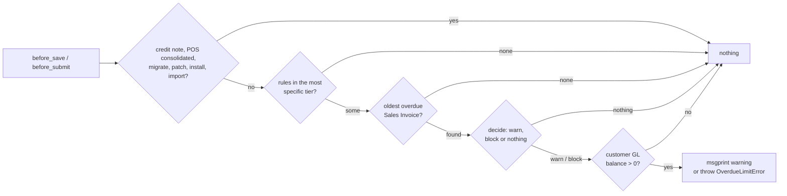

# Time Based Overdue Limit

Developer + power-user reference for the **Time Based Overdue Limit** doctype: when its check runs
on Sales Invoices and Sales Orders, which rules apply, how the overdue days are counted, and what
each action does at each stage. For a click-by-click guide aimed at accountants, see
[user-guide.md](user-guide.md).

---

## What it is

A credit-control rule keyed on the **age** of a customer's debt rather than its amount. It is
ERPNext's Credit Limit (`erpnext/selling/doctype/customer/customer.py`, `check_credit_limit`) with
the same shape: rules on Customer and Customer Group, a customer rule overriding its group's, and
a role that is let through. A rule names one party, an optional company, a day threshold and one
of three actions. The check runs from `doc_events` on **Sales Invoice** and **Sales Order** at
`before_save` and `before_submit`, warns with `frappe.msgprint` or blocks with `frappe.throw`, and
needs no client script.

The doctype is wholly owned by this app and adds no field to another app's doctype, so the
[setup framework](../setup/architecture.md) and its `sync()` patches are not involved.

---

## Where the code lives

The work is split into deciding and doing. The decisions are plain functions that take rows and
return values, with no database access. Everything that reads calls them.

```
optima_payment/overdue_limit/
└── limit.py
    ├── DECISIONS   # pure: skipped documents, rule selection by tier, day count, exemption,
    │               #       one rule's outcome, the document's verdict
    ├── MESSAGES    # the warning / refusal text, one line per rule
    ├── CHECK       # check(doc, stage): loads, decides, then msgprint or throw
    └── QUERIES     # group chain, enabled rules + exempt roles, oldest overdue invoice, GL balance

optima_payment/doc_events/overdue_limit.py   # before_save / before_submit → limit.check
optima_payment/hooks.py                      # doc_events for Sales Invoice and Sales Order

optima_payment/optima_payment/doctype/
├── time_based_overdue_limit/                # the rule; controller validates threshold and duplicates
└── time_based_overdue_limit_exempt_role/    # child table, one Role per row
```

---

## Data model

**Time Based Overdue Limit** (not submittable, named `TBOL-.#####`, title `party`):

| Field | Type | Notes |
|-------|------|-------|
| `enabled` | Check | Default 1. Only enabled rules are loaded or count as duplicates |
| `applies_to` | Select | Customer / Customer Group. Default Customer |
| `party` | Dynamic Link → `applies_to` | Required |
| `company` | Link Company | Optional. Blank means every company (see [Blank company](#blank-company)) |
| `action` | Select | Warn on Save / Block on Save / Block on Submit |
| `threshold_days` | Int | Required, must be above 0 |
| `exempt_roles` | Table MultiSelect → Time Based Overdue Limit Exempt Role | Shown only for the two block actions. Ignored on Warn on Save even when rows remain from an earlier action |

**Time Based Overdue Limit Exempt Role** (child): `role`, Link Role, required.

Controller `validate`:

- `threshold_days` must be above 0.
- No other **enabled** rule may share `applies_to`, `party`, `company` and `action`. A blank company
  only clashes with another blank company, so an every-company rule and a one-company rule with the
  same action can coexist, and both apply.

Permissions: **Accounts Manager** and **System Manager** have full access; **Accounts User** and
**Sales User** read only. If sales users could edit rules or their exempt roles, the control would
be worthless.

---

## When the check runs

Frappe runs `validate → before_save` on a save and `validate → before_submit` on a submit
(`frappe/model/document.py`, `run_before_save_methods`). Submitting from the form does **not** run
`before_save`, which is why a Block on Save rule is checked at submit too.



The cheap checks run first, and the GL balance query only once a warning or block is already
decided.

Skipped documents, `is_exempt_document`:

| Skipped | Why |
|---------|-----|
| `is_return` | A credit note only lowers what the customer owes |
| `is_consolidated` | POS Closing creates these; blocking one would stop the closing |
| `frappe.flags.in_migrate` / `in_patch` / `in_install` / `in_import` | System writes and Data Import are not sales decisions |

Sales Order has neither `is_return` nor `is_consolidated`; `doc.get` returns `None` for them.

---

## Rule selection

`get_group_chain` reads the customer's group (`Customer.customer_group`, not the document's
fetched copy) and its ancestors, nearest first, with one `lft <= … and rgt >= …` query. The
`lft` / `rgt` of the group are read uncached: adding a group renumbers the tree in SQL, which
leaves cached documents stale. `get_enabled_rules` loads every enabled rule naming the customer or
any group in the chain, with their exempt roles.

`select_rules` then keeps the rules whose company is blank or equals the document's, and returns
the first tier that has any, in this order:

```
(Customer, Al Noor Trading) → (Customer Group, Retail) → (Customer Group, Commercial) → (Customer Group, All Customer Groups)
```

Every rule of that tier applies. The company filter runs **before** the tier search, so a
customer rule for another company does not hide the group's rules. `applies_to` is matched with
`party`, so a group named like the customer is still a group.

---

## Day count

`get_oldest_overdue_invoice` returns the Sales Invoice with the earliest `due_date` among:

```
customer = doc.customer, company = doc.company, docstatus = 1, is_return = 0,
outstanding_amount > 0, due_date < today
```

ordered `due_date, name` and limited to one, so the message can name it. `days_overdue` is
`today − due_date`, and a rule triggers when `days >= threshold_days`.

`Sales Invoice.due_date` is the **latest** due date of the payment schedule
(`erpnext/controllers/accounts_controller.py`, `self.due_date = max(due_dates)`). An installment
invoice therefore counts as overdue only after its last installment falls due: the check
under-counts, but never blocks wrongly. Per-installment ageing from `Payment Schedule` is a possible
follow-up.

---

## The action table

`rule_outcome(action, stage, exempt)` for one triggered rule. "Exempt" means the acting user
(`frappe.get_roles()`, the session user, not the document owner) holds one of the rule's exempt
roles, which only counts on the two block actions (`is_exempt_user`).

| Action | Save | Save, exempt | Submit | Submit, exempt |
|--------|------|--------------|--------|----------------|
| **Warn on Save** | warn | warn | — | — |
| **Block on Save** | **block** | warn | **block** | warn |
| **Block on Submit** | warn | warn | **block** | warn |

`decide` combines the triggered rules of the tier into a `Verdict(outcome, hits)`:

- Any block wins. Its hits are only the blocking rules, so the refusal lists only what refuses.
- Otherwise every triggered rule that warns is a hit, and the warning lists them all.
- No triggered rule: `Verdict(None, [])`.

Each `Hit` carries the rule and whether the user was exempt from it; the message turns each into
one line, adding *Your role lets you continue* or the list of exempt roles. A block is raised as
`OverdueLimitError`, a subclass of `frappe.ValidationError`. A warning is `msgprint` with an orange
indicator, and the document is saved.

`frappe.get_roles("Administrator")` returns every role, so Administrator is exempt from any rule
that lists at least one exempt role.

---

## GL balance guard

A Payment Entry or credit note that is not allocated to the invoice leaves its `outstanding_amount`
untouched, so the invoice looks unpaid though the customer owes nothing. Before warning or
blocking, `check` reads the customer's net GL balance for the company:

```
sum(debit) − sum(credit) from `tabGL Entry`
where party_type = 'Customer' and party = … and company = … and is_cancelled = 0
```

and does nothing when it is zero or less. This is the GL half of ERPNext's
`get_customer_outstanding`. It uses the `(party_type, party)` index on GL Entry; on a site with
about 256,000 GL rows it took under half a millisecond for the busiest customer. On that site, 39
of the 90 customer-and-company pairs with an overdue invoice owed nothing overall.

It catches only a customer who owes nothing at all. A customer who paid the old invoice without
allocating it, and now owes only on a newer invoice that isn't due yet, is still blocked by the old
one until the payment is reconciled.

---

## Blank company

Frappe fills an empty Link field of a new document from `frappe.defaults` keyed by the
**fieldname** (`frappe/model/create_new.py`, `get_user_default_value`), and every ERPNext site has
a global `company` default. Left alone, insert would turn every blank-company rule into a
default-company rule. The controller's `__setup__` sets `dont_update_if_missing = ["company"]`, so
the server keeps a blank company blank.

The form still pre-fills the user's default company on a new rule (the client-side
`frappe.model.get_default_value`); clearing it is what makes a rule apply in every company.

---

## Known limits

| Limit | Effect | Possible follow-up |
|-------|--------|--------------------|
| Installment invoices age from their last due date | Overdue installments count late | Age from `Payment Schedule` rows |
| Residual balances count | 0.01 outstanding can block | An "ignore outstanding below" amount |
| Unallocated payments, when other debt remains | The old invoice still counts | None; reconcile the payment |
| A submitted Sales Order does not pass its Sales Invoice | The invoice is checked on its own | Intended |
| Cancel + amend, Auto Repeat and other server inserts | Checked like any save | Intended |

---

## Tests

See [testing.md](../development/testing.md). The check's tests come as a pair in
`optima_payment/overdue_limit/tests/`, and the rule's own validation sits beside the doctype:

| File | Layer | What it proves |
|------|-------|----------------|
| `test_limit.py` | Matrix: plain rules, nothing written | Skipped documents and flags, tier precedence, blank and other company, a group named like the customer, the day count, exemption on block rules only, the whole action table, the threshold boundary (19 / 20 / 21 against 20), block outranking warnings, the message lines |
| `test_limit_integration.py` | Integration: real saves | Each action on Sales Invoice and Sales Order at save and submit, Block on Save refusing an earlier draft's submit, the acting user's roles deciding the exemption, a credit note submitting under a block, an ancestor group's rule applying, another company's rule not applying, payment and an unallocated payment lifting the block, a disabled rule |
| `doctype/time_based_overdue_limit/test_time_based_overdue_limit.py` | Integration | Threshold above 0, the duplicate rule, what is not a duplicate, a blank company staying blank, re-saving a rule |

Every integration test starts from a customer whose Sales Invoice fell due 25 days ago and is
unpaid. The fixtures come from `optima_payment/tests/utils.py`.
