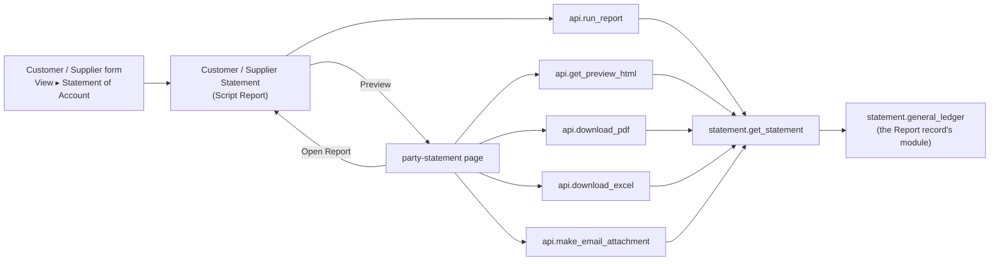

# Statement of Account

Developer + power-user reference for the **customer and supplier statement of account**: where its
figures come from, how one Statement feeds the report, the preview, the PDF, the email attachment
and the Excel file, and who may see it. For a click-by-click guide aimed at accountants, see
[user-guide.md](user-guide.md).

---

## What it is

Two Script Reports, **Customer Statement** and **Supplier Statement**, and a desk page,
**party-statement**, that show one party's ledger for one company and one period. Nothing is
stored: every view recomputes the statement from the General Ledger. The feature adds no doctype,
custom field or property setter, so it ships without a customization patch; the Report and Page
records sync as standard records on migrate.

> **Why the General Ledger.** ERPNext's own **Process Statement of Accounts** builds its statements
> the same way: it calls `general_ledger.execute` for the party and renders the rows with
> `get_pdf`. Reusing the report means the statement inherits the ledger's rules (cancelled entries,
> opening entries, finance books, the user's GL Entry permissions) and always agrees with it.

> **The site's General Ledger, not necessarily ERPNext's.** An app can point the *General Ledger*
> Report record at its own copy of the report through a fixture: on this bench `wts` and
> `property_management` do, and their older copies build the Opening row differently (see
> [The ledger call](#the-ledger-call)). `general_ledger()` runs whichever copy the record points at,
> so the statement's rows, Opening and Closing equal the General Ledger the site's users open.

---

## Where the code lives

The work is split into deciding and doing. The decisions are plain functions that take rows and
return values, with no database access. Everything that reads or renders calls them.

```
optima_payment/party_statement/
├── api.py          # the doors: check_access, run_report (the reports' execute), and the
│                   # whitelisted preview / PDF / Excel / email-attachment methods
└── statement.py
    ├── DECISIONS   # pure: input checks, GL filters, build_statement, dr_cr, the band,
    │               #       report columns / rows / summary, Excel rows, file name
    ├── LEDGER      # get_statement, general_ledger: runs the site's General Ledger report
    └── RENDERING   # render_html (Jinja + printview.html), render_pdf

optima_payment/templates/party_statement/
├── statement.html  # structure only: header, band, columns, rows, totals
└── statement.css   # every visual decision; literal colours for wkhtmltopdf

optima_payment/optima_payment/report/{customer,supplier}_statement/
├── *.json          # Script Report, ref_doctype Customer / Supplier, the four roles
├── *.py            # execute() = api.run_report(<party type>, filters)
└── *.js            # optima_payment.party_statement.report_settings("<party type>")

optima_payment/optima_payment/page/party_statement/
├── party_statement.json  # Page "party-statement", the four roles
├── party_statement.js    # filter fields, the iframe, the five buttons
└── party_statement.css   # the iframe and the empty-state message

optima_payment/public/js/
├── party_statement.js    # app_include_js: report settings, column fitting, balance formatter, form button
├── customer.js           # doctype_js: View ▸ Statement of Account
└── supplier.js           # doctype_js: View ▸ Statement of Account
```

---

## Flow



The page's iframe, the PDF and the email attachment all come from `render_html`, so what the user
previews is byte-for-byte what the party receives. The Excel file is laid out from the same
Statement by `excel_rows`.

---

## The ledger call

`general_ledger(filters)` reads the *General Ledger* Report record, resolves its module's `execute`
the way `Report.execute_module` does, and calls it with the filters themselves. `execute_module`
would pass a copy, and the ledger records the currency it reported in on the filters it is given.

`gl_filters` asks for:

| Filter | Value | Why |
|--------|-------|-----|
| `party_type`, `party` | the party, as a one-item list | One statement, one party |
| `company` | required | One company per statement; the header names it |
| `from_date`, `to_date` | the period | |
| `categorize_by` | `Categorize by Voucher (Consolidated)` | One row per voucher and account, after one opening row. ERPNext reads this name |
| `group_by` | `Group by Voucher (Consolidated)` | The same, under the name the older copies read |
| `include_default_book_entries` | 1 | The company's default finance book plus untagged entries, as the GL report does |
| `show_opening_entries` | 0 | Opening-entry vouchers count towards the opening balance |
| `exclude_credit_debit_notes` | 1 | The `wts` copy's screen default: it leaves out Journal Entries of type Credit Note and Debit Note. Without it the Opening row would differ from the one users see. Other copies ignore the key |
| `presentation_currency` | unset | The ledger reports in the party's **account currency** |

The ledger returns, in this mode: one Opening row (no `posting_date`), the voucher rows, then a
*Total* row and a *Closing (Opening + Total)* row. The copies differ on the Opening row:

| Copy | Opening debit / credit | Closing debit / credit |
|------|------------------------|------------------------|
| ERPNext | the net opening, on one side | Opening + Total |
| `wts`, `property_management` | every earlier debit and every earlier credit, gross | Opening + Total |

`ledger_currency` reads the currency back: ERPNext's copy records `presentation_currency`, the older
copies only an `account_currency` that differs from the company's, so the company currency is the
last fallback.

> **Excluded notes and balances.** Leaving out credit and debit note Journal Entries changes no
> balance when each note debits and credits the same party, which is how system-generated
> reconciliation notes post. On ims.local, 374 of 375 such party postings net to zero; one manual note
> is one-sided, and the statement, like the `wts` General Ledger, leaves it out.

---

## The Statement

`build_statement(gl_rows, precision)` returns a `Statement`:

| Field | Meaning |
|-------|---------|
| `opening_debit`, `opening_credit` | The leading row's debit and credit when it has no `posting_date`, as the ledger shows them; 0 otherwise |
| `opening` | `opening_debit − opening_credit` |
| `entries` | Every row with a `voucher_no`: `posting_date`, `voucher_type`, `voucher_no`, `debit`, `credit`, and the running `balance` |
| `total_debit`, `total_credit` | Sums over the entries |
| `closing_debit`, `closing_credit` | `opening_debit + total_debit`, `opening_credit + total_credit`: the ledger's Closing row, whichever copy built it |
| `closing` | `opening + total_debit − total_credit`, which equals the last entry's balance |

- **Positive is DR.** `dr_cr(amount)` turns a signed balance into `(abs amount, "DR" | "CR")`;
  **zero reads DR**.
- The ledger's trailing Total and Closing rows are **never read**: the totals and the Closing row
  are recomputed, so the statement doesn't depend on their position.
- Every amount is rounded to the GL Entry `debit` precision at each step, and a rounded `-0.0`
  becomes `0.0`. The ledger's float sums leave noise like `2.27e-13` CR in the opening, which would
  otherwise print as CR or as `-0` in an export.
- A voucher that both debits and credits the party's account (an invoice paid at once) is one entry
  with both columns filled.

`StatementHeader` carries what the header shows: company, the company's Arabic name (optima_zatca's
`company_name_in_arabic` on Company), party type, party, party name (`customer_name` /
`supplier_name`, else the ID), the period and the currency.

---

## Report

`api.run_report(party_type, filters)` is the `execute` of both reports. It returns
`columns, rows, None, None, summary`:

- **Columns** — Date, Voucher Type, Voucher No. (Dynamic Link on `voucher_type`), Debit, Credit,
  Balance; the amounts are Currency with `options: "currency"`, and every row carries `currency`.
- **Rows** — a bold *Opening Balance* row, the entries, a bold *Closing Balance* row. The label sits
  in `voucher_type`; `bold: 1` marks the label rows, which carry the ledger's Opening and Closing
  debit and credit. The **balance stays signed**, so Frappe's own report export keeps the side.
- **Summary** — Total Debit, Total Credit (Currency cards) and Outstanding Balance (a Data card such
  as `SAR 300.00 DR`, indicator **Red** for DR and **Green** for CR).

The client formatter (`report_settings` in `public/js/party_statement.js`) shows the balance as
`abs DR` in `text-danger` or `abs CR` in `text-success`, a centred `-` for a zero debit or credit,
translates the voucher type, and bolds the label rows. `add_total_row` is 0: the summary cards carry the totals.

The columns fill the page. Frappe draws report columns at exactly their declared widths, so
`fit_columns` (run from `after_datatable_render`) widens them in proportion to fill the table's
width, and never makes them narrower than declared: a screen too narrow for them scrolls sideways,
as before, rather than cutting amounts off. `keep_columns_fitted` (set up in `onload`) refits on the
full-width toggle, on a window resize, and on returning to the report, so a width change made on
another page is caught too. frappe-datatable's own `fluid` layout is not used, because a window
resize while the report is hidden breaks its widths. Its `ratio` layout is not used either: it
leaves the row number column out of its sum, which causes a sideways scroll, and it has no minimum
width.

Filters: Company (default: the user's), Party (`party`, a Link to the party type), From Date
(default: start of the current fiscal year), To Date (default: today), all required.

---

## Preview page

`/app/party-statement` — `optima_payment.party_statement.Preview` in the page script.

- **Fields** — Party Type (Customer / Supplier), Party (Dynamic Link), Company, From Date, To Date.
  `frappe.route_options` fills them on show (party type first, because changing it clears the
  party); any change re-renders after a 300 ms debounce. The arguments are each control's last
  accepted `value`, not `get_value()`, which reads the input's text and would send a half-typed
  party. A newer request always wins over a slower older one.
- **Body** — an `<iframe>` whose `srcdoc` is `get_preview_html`. The iframe keeps the desk's CSS out
  of the statement and the statement's out of the desk; it grows to the statement's height on load.
- **Buttons** — Send Email (primary), Download PDF, Print (`iframe.contentWindow.print()`, as
  Frappe's print view does), Export to Excel, Open Report.
- **Send Email** — calls `make_email_attachment`, then opens `frappe.views.CommunicationComposer`
  with `doc: {doctype: party_type, name: party}`, the party's `email_id` and a subject, and adds the
  File with `render_attachment_rows(file)`, ticked. Sending goes through
  `frappe.core.doctype.communication.email.make`, so email templates, signatures, the Email Queue and
  the party's timeline all work as for any document email.

---

## Rendering

`render_html` renders `templates/party_statement/statement.html`, then wraps it in
`frappe/www/printview.html` with:

| Context | Value |
|---------|-------|
| `print_style` | `get_print_style()` (Print Settings font and the standard print CSS) followed by `statement.css` |
| `lang` | `frappe.local.lang`, the requesting user's language |
| `layout_direction` | `rtl` when that language is right to left |

`render_pdf` passes the result to `frappe.utils.pdf.get_pdf`. The template follows the print-format
house structure: HTML for structure only, every visual decision in the CSS file, widths in
`<colgroup>`, every cell's alignment stated rather than inherited, and **literal colours** because
wkhtmltopdf ignores CSS custom properties. `statement.css` also hides printview's own action
banner, whose Print / Get PDF links target a doctype print, and holds its look against two things the
site's print setup imposes:

| Imposed by | Rule | Answer in `statement.css` |
|------------|------|---------------------------|
| A Print Style (Print Settings) | `.print-format th { background-color: #eee !important; border-bottom: 0 !important }` | The header shading and the totals' divider repeat `!important` on a more specific selector |
| Bootstrap's print reset, applied in the PDF and the printout | `@media print { * { color: #000 } }` | The band's spans take their colour directly instead of inheriting it |

The band is laid out in the template rather than from `band()` (which the Excel sheet uses), so each
date sits in a `<span dir="ltr">`: inside Arabic text a hyphenated date would otherwise be reordered
to read `2026-10-22`.

> **The company name, not a Letter Head.** The header is the company's name as text, agreed with
> stakeholders instead of a full Letter Head. Its Arabic name follows on the line below when it is
> set and differs from the company's name; the Excel sheet keeps the company's name only.

wkhtmltopdf fetches the print CSS from the site's URL. A PDF made from the command line on a bench
whose site name doesn't resolve fails with `HostNotFoundError`; inside a request it uses the
request's host.

---

## API and access

All in `optima_payment/party_statement/api.py`. Every method takes `party_type, party, company,
from_date, to_date` and starts with `check_access`:

1. `party_type` must be **Customer** or **Supplier** (`ValidationError` otherwise).
2. `frappe.has_permission(party_type, "read", party, throw=True)`.
3. The matching Report must be permitted to the user (`Report.is_permitted()`, by its roles), or
   `PermissionError`.

Then `get_statement` checks that every filter is set (`MandatoryError` naming the missing ones) and
that From Date is not after To Date. The General Ledger applies the user's GL Entry match
conditions on top.

| Method | HTTP | Returns |
|--------|------|---------|
| `get_preview_html` | GET / POST | The full HTML page for the iframe |
| `download_pdf` | GET | `Statement-<party>-<to_date>.pdf` as a download |
| `download_excel` | GET | `Statement-<party>-<to_date>.xlsx` (`make_xlsx`) as a download |
| `make_email_attachment` | POST | `{file: {name, file_name, file_url}, recipients, subject}`; the PDF is saved as a **private, unattached File** in *Home/Attachments*, as the composer's own uploader does without a form. It is saved when the composer opens, so a discarded email still leaves the File behind |

`file_name` replaces `\ / : * ? " < > |` in the party with `-`.

---

## Translations

All labels go through `_()` / `__()`. `translations/ar.csv` adds the statement's strings. "Balance"
and the debit and credit totals already carry translations from other apps that read wrong on a
statement ("Balance" as a budget, "Total Debit" as a discount), so the statement's own labels are
looked up under the translation context **Party Statement** (`statement_label` in Python,
`__(text, null, "Party Statement")` in JS): *Balance*, *Total Debit*, *Total Credit*, *DR*, *CR* and
the Excel column *DR / CR*.

---

## Tests

See [testing.md](../development/testing.md). The tests come as a pair in
`optima_payment/party_statement/tests/`:

| File | Layer | What it proves |
|------|-------|----------------|
| `test_statement.py` | Matrix: plain rows, nothing written | GL filters, opening from the leading row (debit, credit, absent, one-sided or both sides), the Closing row as opening plus totals, the ledger currency fallbacks, an empty period, a running balance crossing zero, totals and closing, the ledger's own trailing rows ignored, float noise rounding to a positive zero, precision, DR / CR including zero, input checks and their messages, report rows and summary cards with their indicators, the band, the Excel layout, file names |
| `test_statement_integration.py` | Integration: real Journal Entries | The Opening row, entries and Closing row equal to the site's own General Ledger for the same party, with a debit and a credit before the period so either Opening style shows, a supplier reading CR, the report's rows and summary cards, the API refusing another party type and a user without the report's roles, an Accounts User getting the print page with the company, its Arabic name and the party, the Excel download |

The integration fixtures come from `optima_payment/tests/utils.py` (`make_party_journal_entry`,
`get_or_create_user`, and the shared party factories). A Journal Entry is the shortest voucher that
posts to a party, and its dates are kept inside the current fiscal year. The PDF path is not run in
the suite: it needs the web server for wkhtmltopdf to fetch the print CSS.
