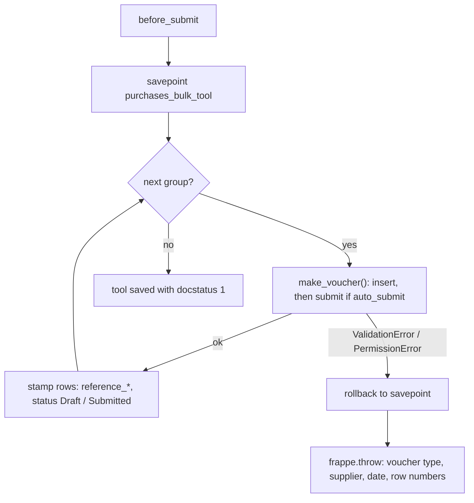
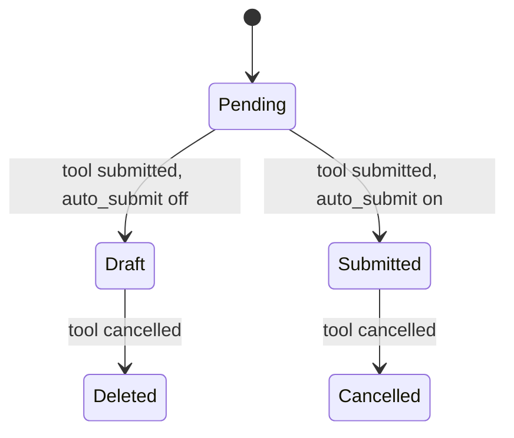

# Purchases Bulk Tool

Developer + power-user reference for the **Purchases Bulk Tool** doctype: how its rows are
grouped into purchase vouchers, how those vouchers are built, and how submit and cancel stay all
or nothing. For a click-by-click guide aimed at accountants, see [user-guide.md](user-guide.md).

---

## What it is

A submittable tool whose child grid holds one purchase per row. Submitting the tool creates a
**Purchase Order**, **Purchase Invoice** or **Purchase Receipt** per group of rows. Cancelling
it cancels or deletes every voucher it created. There is no partial success and no retry: a
failure anywhere leaves nothing behind.

---

## Where the code lives

The work is split into deciding and doing. The decisions are plain functions that take rows and
return values, with no database access. Everything that reads or writes calls them.

```
optima_payment/purchases_bulk/
├── api.py          # whitelisted door for the form: permission check, then one call
└── vouchers.py
    ├── DECISIONS          # pure: grouping, voucher fields, row statuses, failure message
    ├── ROW VALUES         # reads template VAT rates, fills each row's date and amount
    ├── VOUCHER CREATION   # savepoint, insert / submit through each voucher's controller
    └── VOUCHER ROLLBACK   # cancel or delete, the last created first

optima_payment/optima_payment/doctype/purchases_bulk_tool/
├── purchases_bulk_tool.py   # controller: three hooks that hand off to vouchers.py
└── purchases_bulk_tool.js   # form script: pickers, new-row date, live amount
```

Functions with a leading underscore are the decisions. Adding a grouping rule or a voucher field
changes one of them, and its branch is tested with plain rows, no site data needed (see
[Tests](#tests)).

---

## Data model

**Purchases Bulk Tool** (parent, submittable, named `PBT-.#####`):

| Field | Type | Notes |
|-------|------|-------|
| `company` | Link Company | Required. Remembers the last value. Filters the VAT and warehouse pickers |
| `voucher_type` | Select | Purchase Order / Purchase Invoice / Purchase Receipt |
| `set_warehouse` | Link Warehouse | Shown for PO / PR only; copied to each voucher's `set_warehouse` |
| `posting_date` | Date | Defaults to today. Default date for each new row (client) and for any row left blank (server) |
| `auto_submit` | Check | Submit the vouchers too, not only insert them |
| `items` | Table → Purchases Bulk Tool Item | Required |

**Purchases Bulk Tool Item** (child):

| Field | Type | Notes |
|-------|------|-------|
| `voucher_posting_date` | Date | Required. Part of the grouping key |
| `supplier` | Link Supplier | Required. Part of the grouping key |
| `item` | Link Item | Required. Picker limited to `is_purchase_item = 1` |
| `rate` | Currency | Required. Sent as the voucher line's rate, qty 1 |
| `vat` | Link Purchase Taxes and Charges Template | Required. Part of the grouping key; becomes the voucher's `taxes_and_charges` |
| `amount` | Currency | Read-only. `rate × (1 + VAT % / 100)`, the VAT % being the template's On Net Total rates; set in `validate` |
| `status` | Select | Pending / Draft / Submitted / Cancelled / Deleted. Read-only, no-copy |
| `reference_doctype` | Link DocType | Hidden. The voucher's doctype |
| `reference_name` | Dynamic Link → `reference_doctype` | The voucher the row went into |

`vat` is required on purpose. Without a template, ERPNext could pull taxes onto the voucher from
the supplier's tax rule, and the row's `amount` would no longer describe the voucher.

---

## Lifecycle

| Hook | Method | Why there |
|------|--------|-----------|
| `validate` | `vouchers.set_row_values()` | Fills a blank row date from `posting_date` and computes `amount` |
| `before_submit` | `vouchers.create_vouchers()` | The row stamps (`reference_*`, `status`) are then saved with the parent in the same `_save`, with no `db_set` |
| `on_cancel` | `vouchers.rollback_vouchers()` | By `on_cancel`, Frappe has already written the children with docstatus 2 (`update_children` runs before `run_post_save_methods`). Each voucher's back-link check (`check_if_doc_is_dynamically_linked`) then no longer sees a submitted row pointing at it. In `before_cancel` the rows are still docstatus 1 and the voucher's cancel or delete is refused |

---

## Grouping

`_group_rows()` keys the rows by a `GroupKey` of **(supplier, posting date, vat)** and keeps
first-seen order. A date typed as text and the same date as a date object are one key. Each key becomes one voucher, with its rows as the voucher's lines in grid order. The date
and the tax template are both voucher-header fields, so rows that differ in either can't share a
voucher.

---

## Voucher construction

`_voucher_fields()` decides each voucher as a plain dict. `make_voucher()` then creates it with
`frappe.new_doc(voucher_type)` and `update(fields)`, appends the template's taxes, inserts it and
submits it when **Auto Submit** is on:

| Set | Purchase Order | Purchase Invoice | Purchase Receipt |
|-----|----------------|------------------|------------------|
| `company`, `supplier`, `taxes_and_charges = vat` | ✓ | ✓ | ✓ |
| `ignore_pricing_rule = 1` (keeps the typed rate) | ✓ | ✓ | ✓ |
| Date | `transaction_date` and `schedule_date` = group date | `set_posting_time = 1`, `posting_date` = group date | `set_posting_time = 1`, `posting_date` = group date |
| `set_warehouse` (when given) | ✓ | — | ✓ |
| One line per row: `item_code`, `qty = 1`, `rate` | ✓ | ✓ | ✓ |

- **`set_posting_time = 1`** is needed because without it `TransactionBase.validate_posting_time`
  resets `posting_date` to today.
- **`append_taxes_from_master()`** is called before `insert()`. ERPNext copies a template's tax
  rows on the server only when the Accounts Settings flag *Add taxes from Taxes and Charges
  Template* is on. `set_taxes_and_charges` skips when `taxes` is already filled, so the rows are
  never added twice.
- **Permissions:** vouchers are inserted, submitted, cancelled and deleted as the **current
  user**, with no `ignore_permissions`. They are the user's own purchase documents, so the user
  needs those rights on the voucher doctype.

---

## All or nothing



The savepoint is set before the first voucher. On a failure, rolling back to it removes every
voucher already made in this submit, including their GL and stock rows. This holds for any caller:
a web request, `bench execute`, or a test that keeps its transaction open. It doesn't rely on the
request's own rollback. ERPNext's original message stays in the message log above the tool's
summary.

Other exception types are not caught. They propagate unchanged and the request's rollback handles
them.

---

## Cancel rollback

`rollback_vouchers()` takes the unique `(reference_doctype, reference_name)` pairs from
`_vouchers_newest_first()`, in **reverse** creation order, and asks `_rollback_action()` what to
do with each:

| Voucher docstatus | Action | Row status |
|-------------------|--------|------------|
| 1 (submitted) | `cancel()` | **Cancelled** |
| 0 (draft) | `frappe.delete_doc()` | **Deleted** |
| 2 (already cancelled) | none | **Cancelled** |
| missing (deleted outside the tool) | none | **Deleted** |

Row statuses are written with `db_set(..., update_modified=False)` because the tool is already
cancelled.

If a voucher has submitted downstream documents, ERPNext refuses its cancel and the whole tool
cancel aborts. An example is a Payment Entry against the invoice when *Unlink Payment on
Cancellation of Invoice* is off. This is intended.

> **Side effect while submitted.** The tool's submitted row is a live dynamic link to its
> voucher, so Frappe refuses to cancel or delete that voucher on its own. Rollback always goes
> through the tool.

### Row status



`status`, `reference_doctype` and `reference_name` are `no_copy`. An amended tool therefore
starts at **Pending** and creates fresh vouchers.

---

## VAT rate

`vouchers.vat_rates(templates)` reads, for each template, the sum of `rate` over its **On Net
Total** rows, in one query for the whole grid. `validate` uses it for `amount`.

The form script calls `optima_payment.purchases_bulk.api.get_vat_rate(template)` on a `rate` or
`vat` change, and the server recomputes on save. That whitelisted door checks read permission on
the template before reading. `validate` doesn't check it, just as ERPNext doesn't when it copies
the template's taxes onto the voucher.

`amount` is a preview of the voucher's grand total, assuming qty 1 and percentage VAT on the
net. The voucher's own totals can differ when the template has rows this sum ignores or
misreads, such as `Actual` or `On Previous Row …` charges, *Deduct* rows, *Valuation*-only rows
or tax-inclusive rows. They can also differ when an item's Item Tax Template overrides the rate
for the same account.

---

## Tests

See [testing.md](../development/testing.md). The tests come as a pair in
`optima_payment/purchases_bulk/tests/`:

| File | Layer | What it proves |
|------|-------|----------------|
| `test_vouchers.py` | Matrix: plain rows, nothing written | Every branch of the decisions: amount and rounding, grouping by each header value, date fields per voucher type, warehouse, row statuses, rollback order and actions, the failure message |
| `test_vouchers_integration.py` | Integration: real saves | What only a real voucher shows: rows stamped, typed rate and row date kept, template taxes copied, the row amount equal to the voucher's grand total, the savepoint abort, cancel and delete getting past the back-link check, PO and PR |

The integration fixtures come from `optima_payment/tests/utils.py`. The suite owns its whole VAT
chain (account, Item Tax Template, purchase template, items), so no template the site holds
changes a voucher's tax.
