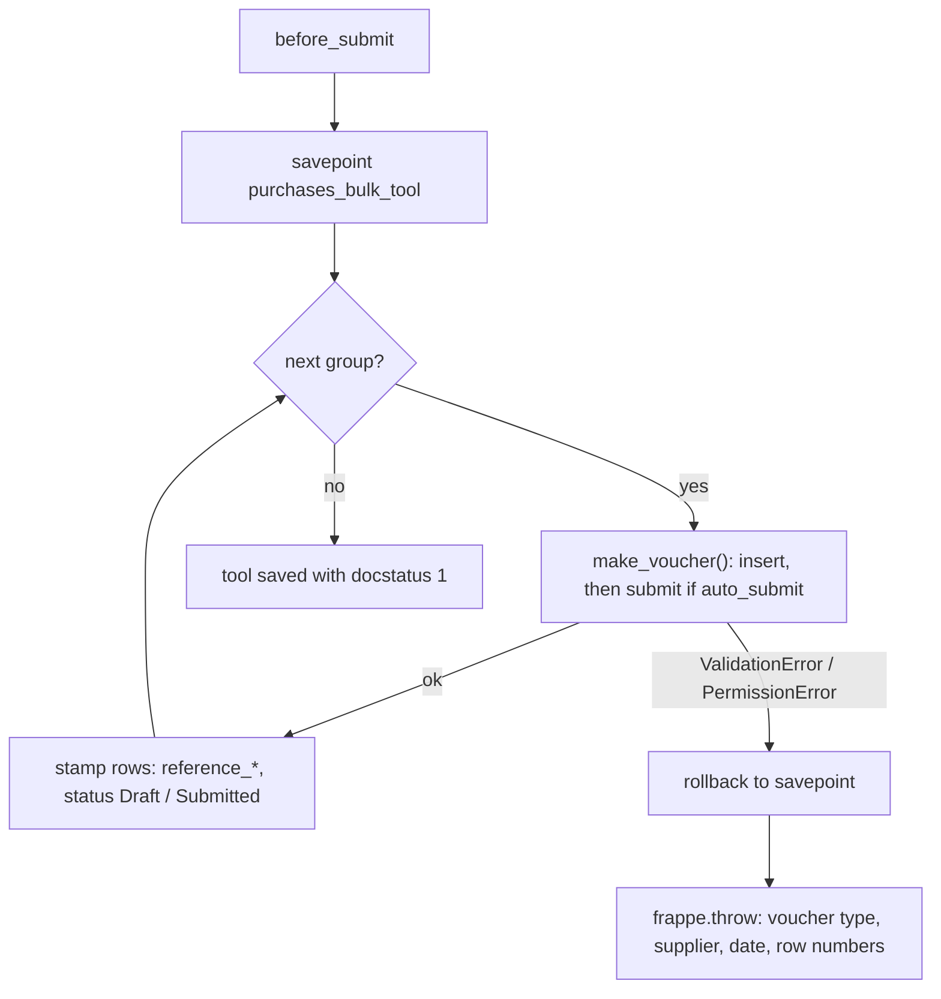
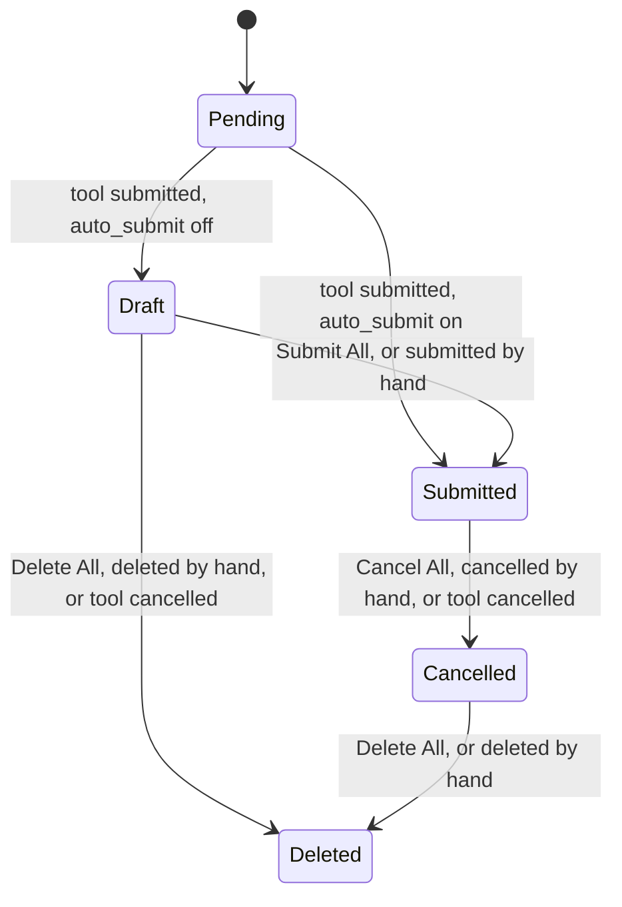

# Purchases Bulk Tool

Developer + power-user reference for the **Purchases Bulk Tool** doctype: how its rows are
grouped into purchase vouchers, how those vouchers are built, how submit, cancel and the bulk
voucher actions stay all or nothing, and how row statuses follow the vouchers. For a
click-by-click guide aimed at accountants, see [user-guide.md](user-guide.md).

---

## What it is

A submittable tool whose child grid holds one purchase line per row, with its own qty and, for
orders and receipts, an optional warehouse. Submitting the tool creates a **Purchase Order**,
**Purchase Invoice** or **Purchase Receipt** per group of rows. While it stays submitted, a
**Vouchers** button group submits, cancels or deletes those vouchers in bulk and reads their
state back onto the rows. A single voucher can also be cancelled or deleted from its own form.
Cancelling the tool cancels or deletes every voucher it created that is still open. Each of these
runs is all or nothing: there is no partial success and no retry, and a failure anywhere changes
no voucher.

---

## Where the code lives

The work is split into deciding and doing. The decisions are plain functions that take rows and
return values, with no database access. Everything that reads or writes calls them.

```
optima_payment/purchases_bulk/
├── api.py          # whitelisted doors for the form: access and input checks, then one call
└── vouchers.py
    ├── DECISIONS                        # pure: grouping, voucher fields and lines, row statuses,
    │                                    #       bulk steps, voucher order, messages
    ├── ROW VALUES                       # reads template VAT rates, fills each row's date and amount
    ├── VOUCHER CREATION                 # savepoint, insert / submit through each voucher's controller
    ├── VOUCHER ROLLBACK                 # cancel or delete, the last created first
    └── VOUCHER STATUS AND BULK ACTIONS  # docstatus read, status sync, Submit / Cancel / Delete All

optima_payment/optima_payment/doctype/purchases_bulk_tool/
├── purchases_bulk_tool.py   # controller: three hooks that hand off to vouchers.py
└── purchases_bulk_tool.js   # form script: pickers, new-row date, live amount, Vouchers buttons

optima_payment/hooks.py      # ignore_links_on_delete releases the rows' voucher link;
                             # after_delete on PO / PI / PR unlinks a deleted voucher's rows
```

Functions with a leading underscore are the decisions. Adding a grouping rule or a voucher field
changes one of them, and its branch is tested with plain rows, no site data needed (see
[Tests](#tests)).

---

## Data model

**Purchases Bulk Tool** (parent, submittable, named `PBT-.#####`):

| Field | Type | Notes |
|-------|------|-------|
| `company` | Link Company | Required. Remembers the last value. Filters the VAT and warehouse pickers |
| `voucher_type` | Select | Purchase Order / Purchase Invoice / Purchase Receipt |
| `set_warehouse` | Link Warehouse | Shown for PO / PR only; copied to each voucher's `set_warehouse`, so it fills every line without its own warehouse |
| `posting_date` | Date | Defaults to today. Default date for each new row (client) and for any row left blank (server) |
| `auto_submit` | Check | Submit the vouchers too, not only insert them |
| `items` | Table → Purchases Bulk Tool Item | Required |

**Purchases Bulk Tool Item** (child):

| Field | Type | Notes |
|-------|------|-------|
| `voucher_posting_date` | Date | Required. Part of the grouping key |
| `supplier` | Link Supplier | Required. Part of the grouping key |
| `item` | Link Item | Required. Picker limited to `is_purchase_item = 1` |
| `qty` | Float | Required, default 1, not negative. Sent as the voucher line's qty |
| `rate` | Currency | Required. Sent as the voucher line's rate |
| `vat` | Link Purchase Taxes and Charges Template | Required. Part of the grouping key; becomes the voucher's `taxes_and_charges` |
| `warehouse` | Link Warehouse | Optional, row form only (not a grid column). Shown when the tool's voucher type is PO / PR. Sent as the line's `warehouse`; blank falls back to `set_warehouse` |
| `amount` | Currency | Read-only. `qty × rate × (1 + VAT % / 100)`, the VAT % being the template's On Net Total rates; set in `validate` |
| `status` | Select | Pending / Draft / Submitted / Cancelled / Deleted. Read-only, no-copy |
| `reference_doctype` | Link DocType | Hidden. The voucher's doctype |
| `reference_name` | Dynamic Link → `reference_doctype` | The voucher the row went into. Emptied, with `reference_doctype`, once that voucher is deleted (see [Deleted vouchers](#deleted-vouchers)) |

`vat` is required on purpose. Without a template, ERPNext could pull taxes onto the voucher from
the supplier's tax rule, and the row's `amount` would no longer describe the voucher.

`warehouse` is optional on purpose. ERPNext requires a warehouse per **stock** line of a PO or PR,
not per voucher type, so a mandatory field would block service lines. When a stock line has none
from any source, ERPNext's own *Warehouse is mandatory* error names the row, above the tool's
failure message.

The grid has 10 column units: Date 1, Supplier 2, Item 1, Qty 1, Rate 1, VAT 1, Amount 1,
Status 1, Voucher 1. That budget is full, so `warehouse` lives in the row form only.

---

## Lifecycle

| Hook | Method | Why there |
|------|--------|-----------|
| `validate` | `vouchers.set_row_values()` | Fills a blank row date from `posting_date` and computes `amount` |
| `before_submit` | `vouchers.create_vouchers()` | The row stamps (`reference_*`, `status`) are then saved with the parent in the same `_save`, with no `db_set` |
| `on_cancel` | `vouchers.rollback_vouchers()` | Runs once the tool's own cancel has passed its checks and its rows are saved at docstatus 2. The rows never block their vouchers' cancel or delete, in this hook or any other, because the link is [released](#released-link) |

---

## Grouping

`_group_rows()` keys the rows by a `GroupKey` of **(supplier, posting date, vat)** and keeps
first-seen order. A date typed as text and the same date as a date object are one key. Each key becomes one voucher, with its rows as the voucher's lines in grid order. The date
and the tax template are both voucher-header fields, so rows that differ in either can't share a
voucher.

---

## Voucher construction

`_voucher_fields()` decides each voucher as a plain dict, with one line per row from `_line()`.
`make_voucher()` then creates it with `frappe.new_doc(voucher_type)` and `update(fields)`,
appends the template's taxes, inserts it and submits it when **Auto Submit** is on:

| Set | Purchase Order | Purchase Invoice | Purchase Receipt |
|-----|----------------|------------------|------------------|
| `company`, `supplier`, `taxes_and_charges = vat` | ✓ | ✓ | ✓ |
| `ignore_pricing_rule = 1` (keeps the typed rate) | ✓ | ✓ | ✓ |
| Date | `transaction_date` and `schedule_date` = group date | `set_posting_time = 1`, `posting_date` = group date | `set_posting_time = 1`, `posting_date` = group date |
| `set_warehouse` (when given) | ✓ | — | ✓ |
| One line per row: `item_code`, the row's `qty`, `rate` | ✓ | ✓ | ✓ |
| Line `warehouse` (when the row has one) | ✓ | — | ✓ |

- **`set_posting_time = 1`** is needed because without it `TransactionBase.validate_posting_time`
  resets `posting_date` to today.
- **Warehouse precedence:** the line's own warehouse, then `set_warehouse`, then the item, item
  group or brand default. A line's warehouse wins because `set_missing_item_details` calls
  `get_item_details` with `overwrite_warehouse=False` (`stock/get_item_details.py`
  `get_item_warehouse`), so `set_warehouse` only fills a blank line. When the lines end up with
  different warehouses, the PO and PR controllers clear the header `set_warehouse`
  (`reset_default_field_value`); each line keeps its own.
- **`append_taxes_from_master()`** is called before `insert()`. ERPNext copies a template's tax
  rows on the server only when the Accounts Settings flag *Add taxes from Taxes and Charges
  Template* is on. `set_taxes_and_charges` skips when `taxes` is already filled, so the rows are
  never added twice.
- **Permissions:** vouchers are inserted, submitted, cancelled and deleted as the **current
  user**, with no `ignore_permissions`. They are the user's own purchase documents, so the user
  needs those rights on the voucher doctype.

---

## All or nothing



The savepoint is set before the first voucher. On a failure, rolling back to it removes every
voucher already made in this submit, including their GL and stock rows. This holds for any caller:
a web request, `bench execute`, or a test that keeps its transaction open. It doesn't rely on the
request's own rollback. ERPNext's original message stays in the message log above the tool's
summary.

Other exception types are not caught. They propagate unchanged and the request's rollback handles
them.

---

## Cancel rollback

`rollback_vouchers()` takes the unique `(reference_doctype, reference_name)` pairs from
`_vouchers_newest_first()`, in **reverse** creation order, and asks `_rollback_action()` what to
do with each:

| Voucher docstatus | Action | Row status |
|-------------------|--------|------------|
| 1 (submitted) | `cancel()` | **Cancelled** |
| 0 (draft) | `frappe.delete_doc()` | **Deleted** |
| 2 (already cancelled) | none | **Cancelled** |
| missing (deleted outside the tool) | none | **Deleted** |

Row statuses are written with `db_set(..., update_modified=False)` because the tool is already
cancelled. A **Deleted** row also loses its voucher link (see [Deleted vouchers](#deleted-vouchers)).

`voucher_docstatuses()` reads every voucher's docstatus in one query before the loop.
`apply_action()` does the cancel or delete, the same function the bulk actions use.

If a voucher has submitted downstream documents, ERPNext refuses its cancel and the whole tool
cancel aborts. An example is a Payment Entry against the invoice when *Unlink Payment on
Cancellation of Invoice* is off. This is intended.

---

## Bulk actions

A submitted tool shows a **Vouchers** button group. Each button calls a POST-only whitelisted
door in `api.py`. The door checks access, refuses a tool that isn't submitted (and an unknown
action), then makes one call into `vouchers.py`:

| Button | Door | Needs on the tool | Calls |
|--------|------|-------------------|-------|
| **Update Status** | `update_statuses(tool)` | read | `sync_statuses()` |
| **Submit All** | `run_bulk_action(tool, "submit")` | submit | `run_bulk_action()` |
| **Cancel All** | `run_bulk_action(tool, "cancel")` | submit | `run_bulk_action()` |
| **Delete All** | `run_bulk_action(tool, "delete")` | submit | `run_bulk_action()` |

The three actions ask for confirmation first, then the form reloads. The tool stays at
docstatus 1 throughout.

`voucher_docstatuses()` reads each voucher's docstatus in one query; a voucher missing from the
result was deleted. `_bulk_step(action, docstatus)` then decides, per voucher, whether the action
takes it and the status its rows end at:

| Voucher docstatus | Submit All | Cancel All | Delete All |
|-------------------|------------|------------|------------|
| 0 (draft) | **submit** → Submitted | skip → Draft | **delete** → Deleted |
| 1 (submitted) | skip → Submitted | **cancel** → Cancelled | skip → Submitted |
| 2 (cancelled) | skip → Cancelled | skip → Cancelled | **delete** → Deleted |
| missing | skip → Deleted | skip → Deleted | skip → Deleted |

Submit All takes drafts and Cancel All takes submitted vouchers. Delete All takes drafts **and
cancelled vouchers**, so a click can clear a tool's vouchers completely. Tool cancel
(`_rollback_action()`) differs here: it keeps cancelled vouchers.

> **Cancelled invoices and receipts keep their ledger rows.** Cancelling a Purchase Invoice or
> Receipt doesn't remove its GL, Stock and Payment Ledger Entries; ERPNext marks them
> `is_cancelled = 1` and leaves them at docstatus 1. Frappe's delete check then refuses the
> voucher (*Cannot delete or cancel because Purchase Invoice … is linked with GL Entry …*), unless
> **Accounts Settings → Delete Accounting and Stock Ledger Entries on deletion of Transaction**
> (`delete_linked_ledger_entries`) is on, in which case ERPNext's `on_trash` deletes those rows
> first. With the setting off, one cancelled invoice or receipt stops the whole Delete All, drafts
> included. Cancelled Purchase Orders post no ledger rows and always delete.

- **All or nothing.** `run_bulk_action()` sets the `purchases_bulk_tool` savepoint before the
  first voucher, as creation does. When a voucher fails with a `ValidationError` or
  `PermissionError`, it rolls back to the savepoint, which undoes every voucher already handled
  in this click and every row status written, and throws `_bulk_failure_message()`: *Could not
  submit Purchase Invoice ACC-PINV-… (rows 1, 3). No voucher was changed.* ERPNext's own message
  stays above it. Other exceptions propagate unchanged.
- **Order.** `_bulk_order()` sends Submit in creation order (`_rows_by_voucher()`), and Cancel
  and Delete newest first (`_vouchers_newest_first()`), the order tool cancel uses.
- **Statuses.** Every row ends at its voucher's status, including the rows of skipped vouchers,
  so any click also corrects stale statuses. `set_status()` writes what `_row_values()` gives
  for that status, only the fields that changed, with `db_set(..., update_modified=False)`. When the action took no voucher, the user
  sees `_nothing_to_do_message()`, such as *No draft voucher to submit.* or *No draft or
  cancelled voucher to delete.*
- **Update Status** runs `sync_statuses()`: it reads the docstatuses and writes
  `_voucher_status()` onto each voucher's rows, and changes no voucher.
- **Permissions.** `apply_action()` submits, cancels or deletes each voucher as the current
  user, with no `ignore_permissions`. Submit permission on the tool lets the user start an
  action; each voucher still needs the user's own right on its doctype, and a refusal aborts
  the click like any other failure.

---

## Released link

`hooks.py` lists **Purchases Bulk Tool Item** in `ignore_links_on_delete`. Without it, a
submitted tool's row is a live Dynamic Link to its voucher, and Frappe
(`check_if_doc_is_dynamically_linked` in `frappe/model/delete_doc.py`) refuses to cancel or
delete the voucher. With it:

- The bulk actions can cancel and delete vouchers while the tool stays submitted.
- A single voucher can be cancelled, amended or deleted from its own form, without cancelling
  the whole tool. A delete updates the rows at once; after a submit or cancel, **Update Status**
  reads the state back onto the rows. A cancelled row keeps pointing at the original voucher,
  not its amendment, and tool cancel never touches the amendment.

There is no narrower bypass. ERPNext's Purchase Order, Invoice and Receipt `on_cancel` assign
`ignore_linked_doctypes` themselves, overwriting anything the tool sets, and `flags.ignore_links`
would also skip real downstream checks such as a Payment Entry against the invoice.

> **Side effect.** On delete, Frappe also ignores the rows' static Link fields
> (`check_if_doc_is_linked` adds the hook's doctypes to its ignore list). A supplier, item, VAT
> template or warehouse that only a tool row uses can then be deleted. On a **Pending** tool this
> surfaces later: its submit fails with Frappe's normal link error for the missing record.

---

## Deleted vouchers

Deleting the newest voucher of a naming series winds the series counter back
(`update_naming_series` → `revert_series_if_last`, in `frappe/model/delete_doc.py` and
`frappe/model/naming.py`). The next voucher of that series, made by hand or by another tool,
then gets the deleted voucher's name. Delete All goes newest first, so every voucher it deletes
is the newest one at that moment, and every name it frees can come back.

A row still holding such a name would adopt a voucher the tool never made: **Update Status**
would show that voucher's state, the bulk actions would submit, cancel or delete it, and
cancelling the tool would cancel or delete it.

So a row keeps no link once its voucher is gone. `_row_values(DELETED)` empties
`reference_doctype` and `reference_name` along with the status, and two places apply it:

- **`unlink_tool_rows()`**, registered in `hooks.py` as the `after_delete` doc_event of Purchase
  Order, Purchase Invoice and Purchase Receipt. It covers every delete — Delete All, tool
  cancel, and a voucher deleted from its own form — in the same transaction as the delete.
  `after_delete` runs only once the delete has passed its link checks, so a refused delete
  changes no row, and Delete All's savepoint undoes these writes with the vouchers.
- **`set_status()`**, for a row whose voucher is found missing when the tool reads the
  docstatuses: one deleted before this hook existed, or removed without `frappe.delete_doc`.

A submit or cancel never frees a name, so those rows keep their link. The deleted voucher stays
in **Deleted Documents**, but the row no longer names it. A voucher restored from there is not
linked back to the tool.

### Row status



The tool's own submit, its cancel, the bulk actions and any voucher delete write the new status
at once. A submit or cancel made from the voucher's form shows after **Update Status**, or the
next bulk action. A **Deleted** row has an empty Voucher column.

`status`, `reference_doctype` and `reference_name` are `no_copy`. An amended tool therefore
starts at **Pending** and creates fresh vouchers.

---

## VAT rate

`vouchers.vat_rates(templates)` reads, for each template, the sum of `rate` over its **On Net
Total** rows, in one query for the whole grid. `validate` uses it for `amount`.

The form script calls `optima_payment.purchases_bulk.api.get_vat_rate(template)` on a `qty`,
`rate` or `vat` change, and the server recomputes on save. That whitelisted door checks read permission on
the template before reading. `validate` doesn't check it, just as ERPNext doesn't when it copies
the template's taxes onto the voucher.

`amount` is a preview of the voucher's grand total, assuming percentage VAT on the net. The voucher's own totals can differ when the template has rows this sum ignores or
misreads, such as `Actual` or `On Previous Row …` charges, *Deduct* rows, *Valuation*-only rows
or tax-inclusive rows. They can also differ when an item's Item Tax Template overrides the rate
for the same account.

---

## Tests

See [testing.md](../development/testing.md). The tests come as a pair in
`optima_payment/purchases_bulk/tests/`:

| File | Layer | What it proves |
|------|-------|----------------|
| `test_vouchers.py` | Matrix: plain rows, nothing written | Every branch of the decisions: amount with qty and rounding, grouping by each header value, date fields per voucher type, header and line warehouse, qty per line, row status per docstatus, which statuses drop the voucher link, each bulk action × docstatus, voucher order both ways, rollback actions, the failure and nothing-to-do messages |
| `test_vouchers_integration.py` | Integration: real saves | What only a real voucher shows: rows stamped, typed qty, rate and row date kept, a row warehouse beating `set_warehouse`, template taxes copied, the row amount equal to the voucher's grand total, the savepoint abort on create and on Submit All, a voucher cancelled or deleted by hand and Update Status reading it back, a hand delete unlinking its rows at once, a voucher given a deleted voucher's name staying out of the tool, each bulk action taking only its own state, tool cancel after Cancel All, the API refusing a draft tool or an unknown action, PO and PR |

The integration fixtures come from `optima_payment/tests/utils.py`. The suite owns its whole VAT
chain (account, Item Tax Template, purchase template, items), so no template the site holds
changes a voucher's tax.
